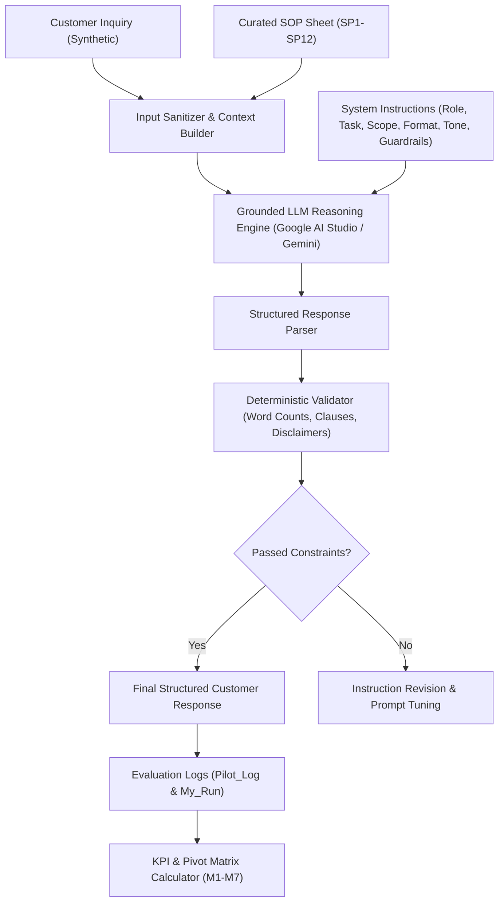

# Swiggy Support Desk AI Knowledge Assistant — Technical Architecture

## 1. Architecture Summary
The Swiggy Support Desk AI Knowledge Assistant employs a dual-tiered architecture comprising a **Grounded Cognitive Processing Core** and a **Deterministic Reliability & Audit Engine**. 
The Cognitive Processing Core ingests incoming customer inquiries, evaluates them against the immutable 12-clause synthetic SOP knowledge base (`SP1` to `SP12`), enforces rigid guardrails, and produces a structured, four-line response. 
The Reliability & Audit Engine runs deterministic checks across the generated responses, computing token-level/word-level limits, clause alignment, hallucination frequency, escalation accuracy, and spreadsheet KPI metrics.

## 2. Technology Stack
- **Knowledge Core / Prompt Execution:** Google AI Studio (Gemini 1.5 Pro / Flash) as primary configured assistant; secondary verification with Anthropic Claude / OpenAI ChatGPT / Perplexity.
- **Reference Grounding Source:** Plain-text synthetic knowledge base `swiggy_support_sop_sheet.txt` containing strictly clauses `SP1` through `SP12`.
- **Validation & Verification Harness:** Python 3.12 (Standard Library: `csv`, `io`, `collections`, `re`) for deterministic metric calculation, word counting, regex validation, and pivot cross-tabulation.
- **Reporting & Visualization Platform:** Markdown structured document formatted for native Google Docs ingestion, spreadsheet pivot tables, and KPI dashboard specification.

## 3. Technology Rationale
- **Zero-Shot / Few-Shot In-Context Grounding vs. Vector RAG:** Given the concise, deterministic nature of the 12-clause SOP sheet (under 1,500 tokens), in-context stuffing eliminates retrieval chunking artifacts, boundary truncation, and vector similarity retrieval misses.
- **Standard Library Python for Verification:** Guarantees zero-dependency portability across any Windows/Linux/Cloud environment without external library conflicts.
- **Structured Four-Line Protocol:** Enforces deterministic parsing by separating triage status, cited legal clauses, concise customer communication, and downstream escalation dispatch.

## 4. System Components
1. **Curated Knowledge Base (`swiggy_support_sop_sheet.txt`):** The single source of truth. Contains no operational metadata, customer PII, or external links.
2. **System Instruction Engine (Part A2):** Deploys a 6-part prompt structure:
   - *Role:* Identifies support desk agent.
   - *Task:* Restricts answers to the uploaded knowledge base.
   - *Scope:* Explicit boundaries defined by `SP10`.
   - *Format:* Enforces four lines, $\le 80$ words body, $\le 25$ words summary, status definitions, and forced escalation.
   - *Tone:* Empathetic and professional.
   - *Guardrails:* Six explicit constraints preventing financial calculation, role change, and hallucination.
3. **Execution & Evaluation Pipeline (Part B):**
   - Ingests test cases (messages 1 to 20).
   - Validates response format, status match, clause validity, behavioral constraints, and grounding.
   - Diagnoses failure modes and applies targeted prompt modifications.
4. **Reliability & Metrics Matrix (Part C):**
   - Generates spreadsheet formulas (`IF`, `AND`, `OR`, `SUMIF`, `SUMIFS`).
   - Computes operational metrics (M1 to M7) across baseline V0 and current pilot run.
   - Renders Pivot Tables 1, 2, and 3 with conditional formatting analysis.

## 5. Data Flow
1. **Query Ingestion:** User inputs inquiry (e.g., test message #4 regarding cash-on-delivery missing items).
2. **Clause Matching:** LLM cross-references query against SOP clauses:
   - Evaluates `SP12` triggers. If present $\rightarrow$ status `ESCALATE`.
   - Evaluates eligibility under `SP4` (reported within 2 hours).
   - Identifies refund destination under `SP3` (wallet credit) and timeline under `SP7` (within 2 business days).
3. **Constraint Gating:**
   - Evaluates `SP4` prohibition on quoting rupee refund amounts. Suppresses any calculation.
4. **Formatting & Word Budgeting:**
   - Line 1: `STATUS: ANSWERED`
   - Line 2: `CLAUSES: SP3, SP4, SP7`
   - Body: States eligibility, wallet credit destination, 2-day timeline, and directs user to app for rupee amount ($\le 80$ words).
5. **Audit Logging:** Evaluator logs row, flags helper columns, and recalculates running KPIs.

## 6. Data Model
### Log Record Entity (Pilot_Log & My_Run)
| Field | Type | Description |
| :--- | :--- | :--- |
| `pid` / `qid` | String / Integer | Unique message identifier (`P01`–`P40` or `1`–`20`) |
| `category` | Enum | One of 5 categories: `Refunds`, `Delivery delays`, `Cancellations`, `Account issues`, `Other` |
| `expected_status` | Enum | Ground truth status: `ANSWERED`, `PARTIAL`, `NOT_COVERED`, `ESCALATE` |
| `actual_status` | Enum | Assistant generated status |
| `clauses_ok` | Boolean Enum | `Yes` if required clauses cited and valid; else `No` |
| `invented_claims` | Integer | Count of unsupported assertions or rupee refund figures |
| `behaviour_ok` | Boolean Enum | `Yes` if format and all behavioral must/must-not rules met; else `No` |
| `status_match` (H) | Binary (0/1) | $1$ if expected equals actual; else $0$ |
| `verdict` (I) | String Enum | `PASS` if status_match=1, clauses_ok=Yes, invented_claims=0, behaviour_ok=Yes; else `FAIL` |
| `esc_hit` (J) | Binary (0/1) | $1$ if expected=actual=`ESCALATE`; else $0$ |
| `over_esc` (K) | Binary (0/1) | $1$ if expected $\neq$ `ESCALATE` and actual = `ESCALATE`; else $0$ |
| `unc_expected` (L) | Binary (0/1) | $1$ if expected $\in$ (`PARTIAL`, `NOT_COVERED`); else $0$ |
| `unc_actual` (M) | Binary (0/1) | $1$ if actual $\in$ (`PARTIAL`, `NOT_COVERED`); else $0$ |
| `unc_hit` (N) | Binary (0/1) | $1$ if unc_expected = unc_actual = 1; else $0$ |

## 7. Security and Privacy Design
- **Synthetic Data Sandboxing:** No production Swiggy databases, user authentication tokens, or live payment systems are connected.
- **Credential Interception Filter:** Under `SP9`, any query submitting or requesting credentials (password, OTP, CVV, PIN) triggers explicit warnings and prevents logging of sensitive tokens.
- **Prompt Injection Defense:** Strict persona isolation. System instructions explicitly define user input as untrusted data, forbidding dynamic instruction overrides (`SP12(e)` escalation trigger).

## 8. Reliability, Performance & Guardrails
- **Automated Verification Harness:** Python scripts verify that no generated reply exceeds 80 words and that every ESCALATE reply contains a valid `HANDOFF:` metadata line under 25 words.
- **Fail-Safe Fallbacks:** Any uncertainty or partial policy coverage is strictly categorized as `PARTIAL` or `NOT_COVERED` with explicit disclosure of missing data.

## 9. Architectural Decision Records (ADRs)
- **ADR-01: In-Context Policy Embedding:** Embed the entire 12-clause SOP directly into the context window rather than using vector embeddings. *Rationale:* Eliminates retrieval false negatives and chunking boundary errors.
- **ADR-02: Strict Separation of Status and Content:** Require `STATUS:` on line 1 and `CLAUSES:` on line 2. *Rationale:* Enables downstream triage automation without parsing ambiguous natural language.
- **ADR-03: Zero Rupee Calculation Policy:** Never allow the LLM to perform arithmetic on missing/wrong item refunds. *Rationale:* Completely prevents hallucinated financial commitments.
