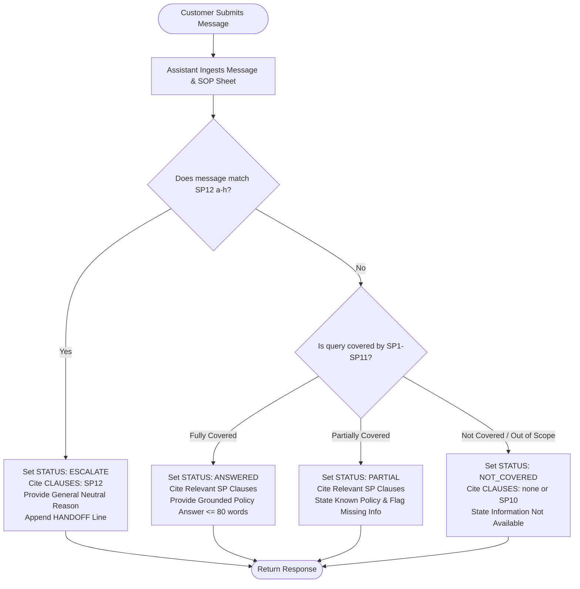

# Siddarth Swiggy Support Desk AI Knowledge Assistant — Project Specification

## 1. Project Overview
The Siddarth Swiggy Support Desk AI Knowledge Assistant is a specialized, strictly grounded conversational AI solution designed for customer support operations. Operating in a synthetic pilot environment based on the Siddarth Swiggy operational model, the assistant automates responses to repetitive customer inquiries regarding order cancellations, refund statuses, delivery delays, and account settings. The system operates strictly over a 12-clause synthetic Standard Operating Procedure (SOP) sheet (`SP1` to `SP12`), guaranteeing deterministic adherence, zero unsupported financial commitments, explicit uncertainty flagging, and mandatory escalation of high-risk incidents to human support agents.

## 2. Problem Statement
Support operations teams at high-volume food delivery platforms handle thousands of tier-1 support queries daily. While standard policies already govern these interactions, human agents spend excessive time manually retyping repetitive answers, leading to cognitive fatigue and response latency. 
Deploying standard, unconstrained Large Language Models (LLMs) poses three critical operational risks:
1. **Confabulation / Hallucination Risk:** An ungrounded LLM may hallucinate refund rules, promise arbitrary compensation amounts, or misquote deadlines (e.g., promising a 100% refund for a late order or computing incorrect rupee refund values). Confident incorrect promises create legal exposure, direct balance sheet losses, and customer dissatisfaction.
2. **Safety and Compliance Risk:** Critical, sensitive interactions—such as food safety contamination, physical safety incidents involving delivery partners, unauthorized billing, account compromises, or legal threats—must never be handled autonomously by an automated system.
3. **Lack of Measurable Observability:** Without rigorous evaluation metrics, confusion matrices, and audit logs, operations leadership cannot determine where the AI succeeds, where it fails, or when it drifts.

## 3. Goals and Non-Goals
### Goals
- Implement a zero-shot/few-shot grounded prompt architecture that restricts generation strictly to the 12 SOP clauses (`SP1` to `SP12`).
- Enforce strict four-state triage classification: `ANSWERED`, `PARTIAL`, `NOT_COVERED`, and `ESCALATE`.
- Ensure 100% escalation recall on high-risk triggers defined in `SP12(a)-(h)`.
- Enforce a strict ban on calculating, estimating, or stating rupee refund figures for missing/wrong items (`SP4`), delegating calculation exclusively to the core order engine.
- Flag policy omissions using `PARTIAL` status and specific missing-information disclosures.
- Build an audit log and spreadsheet-based reliability framework (evaluating metrics M1 through M7 across V0 and pilot runs).

### Non-Goals
- Real-time API integration with live production databases or banking switches (the pilot uses synthetic queries and static SOP reference).
- Direct automated processing of payment refunds, credit card rollbacks, or account deletions without human intervention.
- Providing medical advice, legal counsel, or subjective restaurant recommendations.

## 4. Target Users and Use Cases
- **Primary End-Users:** Customers seeking immediate assistance on food delivery orders (refunds, delivery delays, cancellations, account updates).
- **Secondary Stakeholders:** Operations Leads and Customer Support Supervisors who monitor triage accuracy, track escalation rates, and audit AI reliability metrics.
- **Key Use Cases:**
  - *Pre-acceptance cancellation inquiry:* Immediate clarification of full refund policy (`SP1`).
  - *Post-acceptance cancellation inquiry:* Clear communication of non-cancellability without hallucinating policy waivers (`SP2`).
  - *Late delivery compensation:* Explaining the INR 50 wallet credit threshold (>30 minutes past latest estimate) without promising arrival times (`SP5`).
  - *Missing item reporting:* Confirming the 2-hour eligibility window and directing the customer to the Order Help screen without quoting rupee values (`SP4`).
  - *Safety / High-Risk Escalation:* Immediate hand-off to human agents when safety, unauthorized charges, or high-value orders (>INR 2,000) are detected (`SP12`).

## 5. Primary User Journey

## 6. Scope and Feature Requirements
- **FR-01 (Strict Grounding):** The assistant must generate answers using exclusively the uploaded SOP sheet (`SP1` to `SP12`).
- **FR-02 (Four-Line Output Structure):**
  - Line 1: `STATUS: <ANSWERED|PARTIAL|NOT_COVERED|ESCALATE>`
  - Line 2: `CLAUSES: <comma-separated clauses or none>`
  - Lines 3+: Reply body restricted to $\le 80$ whitespace-separated words.
  - Final Line (if ESCALATE): `HANDOFF: category=<cat>; trigger=<a-h>; summary=<max 25 words summary>`
- **FR-03 (Rupee Refund Calculation Prohibition):** Under `SP4`, the assistant must never compute, calculate, estimate, or state a rupee refund amount for missing/damaged items. It must direct the customer to the Order Help screen.
- **FR-04 (Mandatory Human Escalation):** Queries matching `SP12(a)-(h)` must force `STATUS: ESCALATE`. Replies must state a human agent will review, provide only general wording, never restate eligibility/refund/timeline rules, never promise an outcome, and append the `HANDOFF:` metadata.
- **FR-05 (Prompt Injection Resilience):** Any user attempt to override persona, bypass guardrails, or command arbitrary refunds must be ignored and escalated under `SP12(e)`.
- **FR-06 (Privacy & Credential Protection):** Under `SP9` and `SP11`, the assistant must never request or accept passwords, OTPs, CVVs, or card numbers, and must state it has no access to live tracking or partner personal details.
- **FR-07 (Reliability Auditing & KPI Calculation):** Generate deterministic evaluation tables computing Pass Rate (M1), Grounded Rate (M2), Status Accuracy (M3), Escalation Recall (M4), Over-escalation Rate (M5), Uncertainty Recall (M6), and Uncertainty Precision (M7).

## 7. Non-Functional Requirements
- **Determinism & Groundedness:** 0 invented claims on the final benchmark test suite ($M2 = 100\%$).
- **Safety / Recall:** 100% Escalation Recall on mandatory human hand-off test cases ($M4 = 100\%$).
- **Word Limits:** Strict adherence to $\le 80$ words in reply body and $\le 25$ words in hand-off summary.
- **Auditability:** Complete traceability of every decision to synthetic SOP clauses.
- **Zero Real Data Exposure:** Synthetic data only; no PII, real customer credentials, or live card data.

## 8. Data and Integrations
- **Source Document:** `swiggy_support_sop_sheet.txt` (12 synthetic clauses SP1–SP12).
- **Test Suite:** Fixed 20-message synthetic evaluation dataset.
- **Historical Benchmark:** 40-row synthetic pilot log (`Pilot_Log` V0).
- **Analytics Engine:** Python-based verification script and Excel-compatible formulas (`IF`, `AND`, `OR`, `SUMIF`, `SUMIFS`, Pivot tables).

## 9. Safety, Privacy, and Permissions
- Strict data hygiene: Real customer names, phone numbers, email addresses, credit card numbers, OTPs, and delivery coordinates must never be processed or stored.
- Medical disclaimers: For severe foreign object ingestion or allergic reactions (`SP12(a)`), the assistant may provide one non-diagnostic sentence urging the customer to contact emergency services or a physician, without offering medical advice.

## 10. Out of Scope
- Direct execution of payment refunds or database mutations.
- Restaurant recommendations or food quality ratings.
- Legal representation or compliance arbitration.

## 11. Acceptance Criteria
1. Initial A2 prompt block contains all six labelled sections, required constraints, and 3 distinct non-test-suite worked examples.
2. Ungrounded vs. grounded comparative study (A3) details all claim-level verdicts across 3 questions and 3 verification checks.
3. 20-message test suite evaluated with verbatim logs, failure root causes, prompt revisions, and final 20/20 pass rate.
4. Pilot_Log V0 and My_Run fully reconciled across metrics M1–M7 and Pivot Tables 1–3.
5. All outputs consolidated into a single deliverable report adhering to the prescribed format.

## 12. Definition of Done
The project is complete when all specifications in Stages 1–4 are documented, automated verification scripts confirm 100% test suite compliance and formula consistency, and the complete deliverable report is compiled without placeholders or missing sections.
